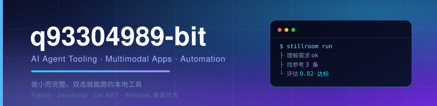

<div align="center">



<br />


<br /><br />

<a href="mailto:q93304989@gmail.com"></a>
<a href="mailto:747055153@qq.com"></a>
<a href="https://github.com/q93304989-bit"></a>

<br /><br />

<b>简体中文</b> · <a href="#-关于我">关于我</a> · <a href="#-技术栈与技能">技术栈</a> · <a href="#-项目">项目</a> · <a href="#-每日自动化">自动化</a> · <a href="#-联系我">联系我</a>

</div>

---

## 👋 关于我

中文技术开发者，长期关注 **AI Agent 生态与多模态应用**。偏好做「小而完整、装完就能用」的本地工具 —— 不需要 GPU、不需要服务器、不需要注册账号，双击就能跑起来。

| | |
| :-- | :-- |
| 🔭 **正在做** | [Stillroom](https://github.com/q93304989-bit/stillroom) —— 判断优先的本地多模态生成工作台。你只说一句需求，**代码**跑完六步流水线，模型只回答窄问题 |
| 🤖 **关注方向** | 编码代理的 Skill 与 harness 编排 · Agent 记忆与长期档案机制 · 多模态生成 API 的工程化封装 |
| 🧰 **主力技术栈** | Python · JavaScript / Node.js · C# / .NET 8 · YAML（Agent 预设与 Skills） |
| 🌱 **在折腾** | 把重复的信息整理交给自动化流水线，人只处理「值得判断」的那部分 |
| 📍 **坐标** | 深圳 Shenzhen · 开放 AI / LLM 方向机会 |
| 📬 **联系我** | [q93304989@gmail.com](mailto:q93304989@gmail.com) · [747055153@qq.com](mailto:747055153@qq.com) |

> 一句话概括我的偏好：**能用代码写死的流程，就不要交给模型猜。**

---

## 🛠 技术栈与技能

<p>
  
  
  
  
  
  
  
  
  
  
  
  
</p>

| 方向 | 具体能力 |
| :-- | :-- |
| **桌面应用** | PySide6 + Qt Quick 现代 GUI · CustomTkinter · PyInstaller 打包分发（单文件 EXE / onedir 绿色版） |
| **AI / Agent 工程** | 多模态生成 API 封装（文生图 · 图生图 · 文生视频 · 图参考视频）· MCP 工具协议 · Skill 与 Agent 预设编排 · Agent 长期记忆机制 · 本地 RAG 与知识库检索 · 提示词评测与版本化 |
| **工程与自动化** | 零依赖 Node 服务（仅用内置模块）· 定时流水线（抓取 → AI 加工 → 归档 → 通知）· 本地 SQLite 存储与检索 · 缓存策略（ETag / single-flight / SWR） |
| **跨栈经验** | Windows 原生工具链（GDI / 注册表 / ctypes）· Git 与仓库治理 · 中英文技术文档撰写 |

---

## 🚀 项目

### 概览

| 项目 | 一句话 | 技术栈 |
| :-- | :-- | :-- |
| **[qianke-engine](https://github.com/q93304989-bit/qianke-engine)** | 电商数据与知识双轨问答引擎：双轨检索 + Text2SQL + 防幻觉审查；附 79 秒宣传片 | Python · FastAPI · Vue 3 · pgvector |
| **[Stillroom](https://github.com/q93304989-bit/stillroom)** | 判断优先的本地多模态生成工作台：说完一句，代码跑完六步流水线 | Python · PySide6 |
| **[github-trending-chat](https://github.com/q93304989-bit/github-trending-chat)** | 把 GitHub Trending 装进一台复古 CRT 终端，外带每日自动归档 | Node.js（零依赖） |
| **[codex-skill-manager](https://github.com/q93304989-bit/codex-skill-manager)** | 三列窗口管理 Codex 技能在哪生效，选中即双向搬移 | C# · .NET 8 |
| **[dsh-super-learning-architect](https://github.com/q93304989-bit/dsh-super-learning-architect)** | 把大模型从「倒课讲师」改造成苏格拉底式私教的 Agent 预设 | YAML · Skills |
| **[jev-lab](https://github.com/q93304989-bit/jev-lab)** | 最简 Jev 调用演示器：单页分类器，把概率分布与耗时摊开给你看 | HTML |
| **[codex-canvas-format-mismatch](https://github.com/q93304989-bit/codex-canvas-format-mismatch)** | Codex 渲染不了 `.canvas.tsx` 的实测取证报告 | PowerShell |

---

### 🥇 Stillroom · 判断优先的本地多模态工作台


**你只说一句需求，代码跑完六步流水线，模型只回答窄问题。**

它不打算和无限画布类工具比谁更能手动编排 —— 重心完全不同：**画布优先 vs 判断优先**。

```text
理解需求 → 找参考 → 生成 → 评估 → 精修 → 交付
   ↑                    ↑      ↑
   └ 判断链（Jev）      └ 预算 / 白名单 / 审批 / 限流都在这一层强制生效
```

- 🧭 **流程写死在代码里**：阶段顺序、回修上限（2 轮）、什么条件算通过，模型改不了
- 🗂 **可裁决的上下文**：点「开始」不直奔生成，先把「理解 + 找参考」摊成一张看得见、改得动的卡；**你删掉的条目本次运行不许复活**
- 🔍 **三层参考来源**：历史作品（A-RAG）· 用户知识库 · 联网兜底，各自带阈值
- 🧪 **生成后自动评估**：视觉模型描述 → Jev 打分 → 达标 / 精修 / 请示
- 🔒 **本地优先**：密钥在 exe 同级的 `.env`，数据在本机 SQLite —— 不出本机、不需要服务器
- 📦 **onedir 绿色版**：双击即用，不需要装 Python

> 原名 Agnes Studio，2026-09-26 更名，原因与迁移说明见仓库 CHANGELOG。

---

### 🎬 千客引擎 · 让电商数据听懂中国话

[](https://www.bilibili.com/video/BV1g9nJ6hEZ9)

**面向电商的「数据 + 知识」双轨问答引擎。** 把订单 CSV 和业务规则 Markdown 拖进来，系统自动清洗、识别字段、构建用户画像与文档索引；业务人员用一句中文提问，就能拿到**带引用来源**的答案。

- 🧭 **意图路由**：知识问答走混合检索（BGE-M3 稠密+稀疏 + BM25 → RRF → Cross-Encoder 精排），统计问题走 Text2SQL
- 📚 **双轨检索**：画像池与文档池分池召回，避免几千条画像把 SOP / 口径挤出上下文
- 🛡 **防幻觉**：关键结论必须带 `[来源N]`；后置 answer guard 拦截预测/越界内容，宁可拒答也不编造
- 🔒 **多租户 + 私有化**：企业独立物理库、字段级脱敏、docker compose 私有化部署
- 📊 **可回归评测**：33 道业务黄金题，LLM-as-a-Judge 通过率 **97.0%**，内置 85% CI 门禁
- 🎬 **79 秒宣传片**：[B 站观看](https://www.bilibili.com/video/BV1g9nJ6hEZ9)（6 段 AI 空镜 + 真实产品录屏 + 配音字幕）

> 技术栈：FastAPI · PostgreSQL + pgvector · BGE-M3 · DeepSeek · Vue 3；Apache-2.0 开源。

---

### 🔧 其他作品

**[github-trending-chat](https://github.com/q93304989-bit/github-trending-chat)** —— **把 GitHub Trending 装进一台复古 CRT 终端。**


零依赖实现 —— 只用 Node 内置模块和原生 HTML / CSS / JS，没有构建步骤，克隆下来直接跑。前端是磷光绿扫描线 + 瀑布入场动效的终端界面，支持 `daily / weekly / monthly` 切换与 vim 式 `J / K / Enter / C` 键盘导航；后端在缓存上下了功夫：ETag / 304 协商缓存、single-flight 合并并发请求、SWR 过期先回旧数据、失败后 30s → 5min 指数冷却。

📁 归档成果：[历史 github 日榜汇总](https://github.com/q93304989-bit/github-trending-chat/tree/main/%E5%8E%86%E5%8F%B2github%E6%97%A5%E6%A6%9C%E6%B1%87%E6%80%BB) —— 每天新增一份，按 年 / 月 / 日 归档

**[codex-skill-manager](https://github.com/q93304989-bit/codex-skill-manager)** —— **双击即用、不装任何环境的 Windows 小工具，管理 Codex 技能在哪里生效。**

把三列 —— 全局技能、系统内置（锁定）、项目技能 —— 摊开在一个窗口里，选中就能双向搬：项目 → 全局、全局 → 项目，或者停用 / 启用。设计上的坚持：系统内置技能（`.system`）和原生插件目录**只读锁定，绝不触碰**；每个动作执行前弹窗确认；「停用」只是把 `SKILL.md` 改名成 `SKILL.md.disabled`（Codex 递归扫描，单纯移动文件夹并不能让它失效），随时能改回来。界面中英文可切换。

**[dsh-super-learning-architect](https://github.com/q93304989-bit/dsh-super-learning-architect)** —— **超级学习架构师：一个把大模型从「一次性倒完课的讲师」改造成苏格拉底式私教的 Agent 预设。**

针对八个常见痛点做设计：讲完立刻追问而不是一屏塞完、按「识记 → 理解 → 应用」三层出题并判卷讲错因、用长期记忆存学生档案实现跨会话不健忘、用待办到期做近似间隔复习、每个术语都配一个「10 岁孩子也能懂」的比喻，以及图表用 matplotlib 生成真实图形后**直接显示在对话里**，而不是丢一个文件路径。预设层只替换 persona，技能层是两本可加载的操作手册（`socratic-tutor` / `socratic-charts`）。纯文件安装，复制即可。

**[jev-lab](https://github.com/q93304989-bit/jev-lab)** —— **最简 Jev 调用演示器。**


一个单页分类器：打开网页、贴上 API Key、点一下，就能看到完整的请求 JSON、每个类别的概率分布、confidence，以及这次调用的耗时和 token 用量。这个仓库只做一件事 —— 用最少的概念和代码，把「代码负责流程，模型负责判断」讲清楚。

**[codex-canvas-format-mismatch](https://github.com/q93304989-bit/codex-canvas-format-mismatch)** —— **一份带复现脚本的实测取证报告。**

Codex 会写出 `*.canvas.tsx`，但没有任何东西能打开它 —— 因为 `~/.agents/skills/canvas/SKILL.md` 是 Cursor canvas skill 的 fork，改名 `Cursor → Codex` 时只换了品牌词，路径、import 和 SDK 引用仍指向 Cursor。`evidence/reproduce.ps1` 可复跑全部检查项。中英双语。

---

### 📦 历史归档

**[AgnesStudio](https://github.com/q93304989-bit/AgnesStudio)** —— Stillroom 的早期版本（原名 Agnes Studio）。面向学生与初学者的多模态桌面练手工具（文生图 / 图生图 / 文生视频 / 图参考视频四合一），CustomTkinter + PyInstaller 单文件 EXE。

> **已更名为 [Stillroom](https://github.com/q93304989-bit/stillroom)，后续开发都在新仓库进行。** 本仓库保留作为历史版本。

---

## ⚡ 每日自动化

把「看趋势」这件事整个交给了流水线，每天 09:00（GMT+8）自动跑一遍。

<details>
<summary><b>展开流水线细节</b></summary>

<br />

```text
09:00  抓取 GitHub Trending (since=daily)
         │  失败自动重试 3 次
         ▼
       解析 → 生成 markdown
         ▼
       AI 为每个仓库写一句中文简评 → 写回归档文件
         ▼
       git commit → push 到 GitHub
         ▼
       发送日报邮件（Top 5 增速 + 看点速览 + 完整榜单链接）
```

设计上几个刻意的取舍：

- **时区锁死 `Asia/Shanghai`** —— 避免跨时区机器把 09:00 的榜归档到前一天
- **内容与已归档文件一致时跳过提交** —— 不制造空提交
- **归档与简评合并成一个 commit** —— 不留碎提交

</details>

---

## 📊 GitHub 数据

<p>
  
  
  
  
  
  
</p>

### 提交贡献图

<div align="center">
  
</div>

---

## 📬 联系我

<p>
  <a href="mailto:q93304989@gmail.com"></a>
  <a href="mailto:747055153@qq.com"></a>
</p>

- **邮箱**：q93304989@gmail.com（推荐）· 747055153@qq.com
- **GitHub**：[@q93304989-bit](https://github.com/q93304989-bit)
- **合作方向**：AI Agent 工具链 · 多模态应用工程化 · 桌面端 AI 工具。欢迎 issue 或邮件。

---

<div align="center">

由 [github-trending-chat](https://github.com/q93304989-bit/github-trending-chat) 的每日归档流水线持续更新

<sub>README 最后整理于 2026-10-19</sub>

</div>
